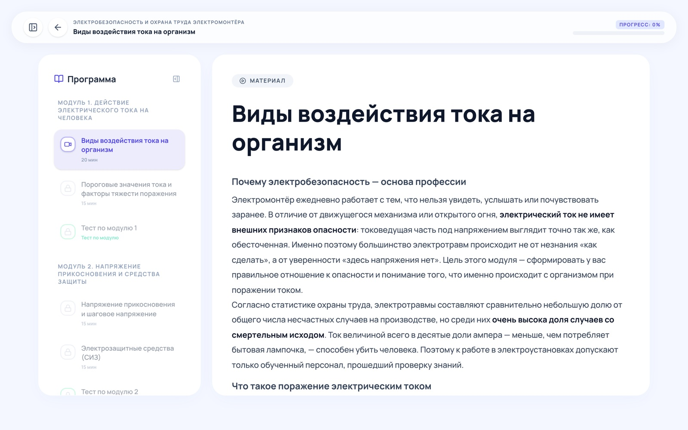
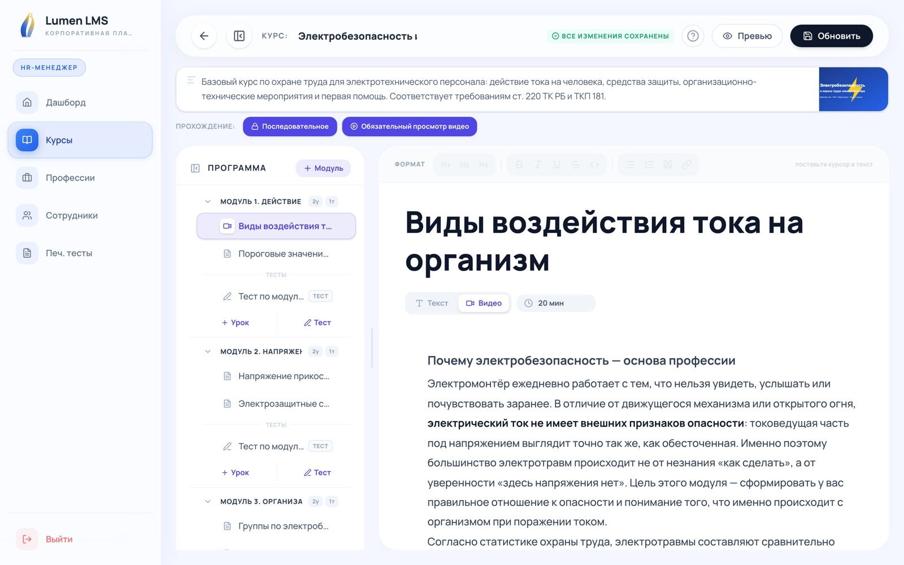
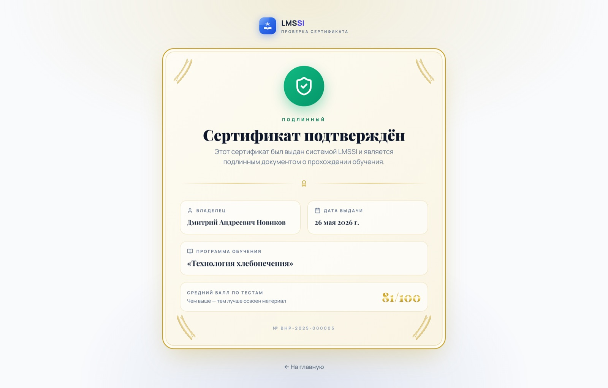
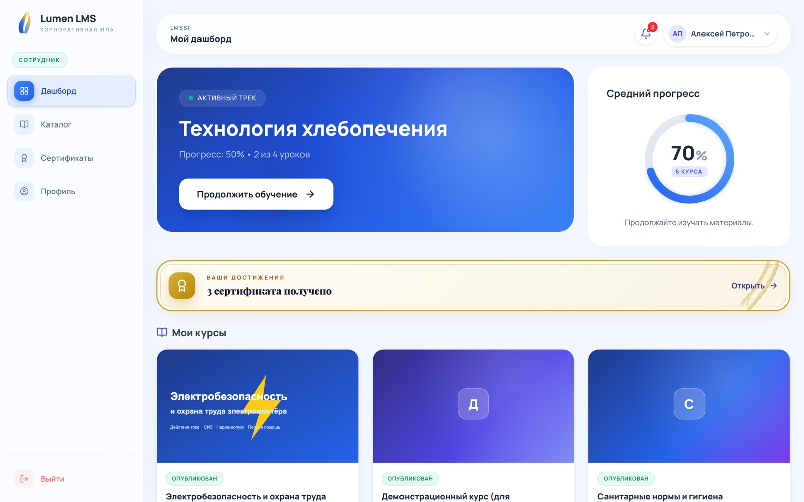
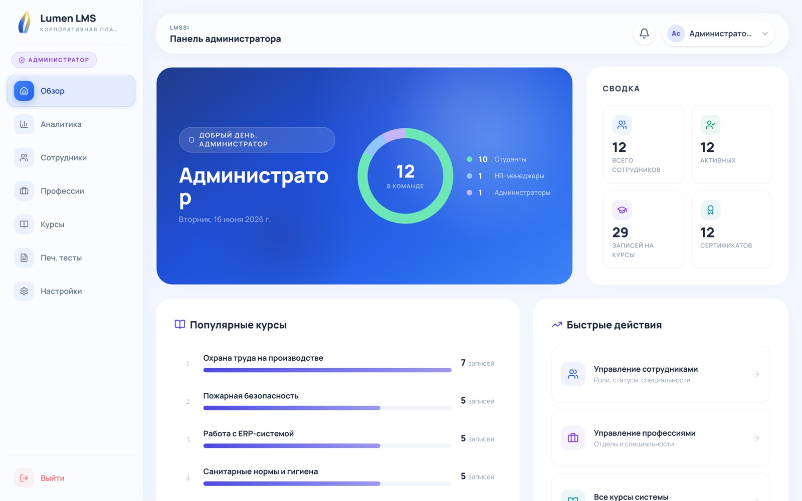

# LMSSI

Корпоративная система обучения для производственного предприятия. HR загружает
инструкцию в PDF или Word — система делает из неё курс с уроками и тестами.
Сотрудник проходит курс, сдаёт тесты и получает сертификат, подлинность
которого можно проверить по QR-коду.

Дипломный проект, 2026. Заказчик — ОАО «Барановичхлебпродукт».



## Зачем

Тема диплома: система обучения сотрудников для ОАО «Барановичхлебпродукт». Готовых LMS много, и ещё один Moodle предприятию не нужен. Мне показалось, что у таких систем самое слабое место не прохождение курсов, а их наполнение. Инструкции и регламенты у предприятия уже есть в Word и PDF, а переделывать их вручную в курс с уроками и тестами долго.

Поэтому главное в LMSSI это сборка курса из документа. ИИ делает черновик, а HR не пишет курс с нуля, а правит готовое в конструкторе.

В демо вместо данных завода вымышленная IT-компания «НордБайт», чтобы не показывать внутренние документы.

## Что умеет

**Сотрудник**
- проходит курсы своей должности — программа назначается автоматически по отделу и должности;
- читает уроки, смотрит видео, решает встроенные вопросы, задаёт вопросы ИИ-наставнику по уроку;
- сдаёт тесты по модулям: вопросы перемешиваются, уход со вкладки фиксируется;
- получает сертификат, когда пройдено всё.

**HR**
- собирает курс в конструкторе или генерирует его из документа;
- включает строгий режим: последовательное прохождение и обязательный просмотр видео;
- назначает курсы, видит прогресс сотрудников, выгружает отчёт в CSV;
- печатает бумажные варианты тестов для тех, кто работает без компьютера.

**Все**
- проверка сертификата по номеру или QR-коду — без входа в систему.

| | |
|---|---|
|  |  |
| Конструктор курса | Публичная проверка сертификата |
|  |  |
| Дашборд сотрудника | Панель администратора |

## Как курс получается из документа

1. Из PDF, DOCX, PPTX или TXT вытаскивается текст (до 60 тыс. символов).
2. Модель строит структуру: модули и уроки с учётом выбранного объёма, тона и уровня слушателей.
3. Уроки и тесты по модулям генерируются параллельно (до 5 запросов одновременно). Ответ модели —
   JSON с блоками: текст, подсказки, чек-листы, вопросы.
4. Всё, что пришло от модели, проверяется: битые вопросы (нет правильного ответа, один вариант) и пустые блоки
   отбрасываются, а не попадают в курс.
5. Если нужно, добавляется итоговый тест. Готовый курс сразу появляется в списке курсов —
   HR открывает его в конструкторе и правит.

Генерация идёт в фоне, фронт показывает прогресс. Работает с любым OpenAI-совместимым API.

## Что было сложно

Ответы модели нельзя брать как есть. JSON приходит то в markdown-обёртке, то с пояснением вокруг. В тестах попадаются вопросы с одним вариантом или с правильным ответом, которого нет среди вариантов. Поэтому ответ сначала очищается от обёртки, а если и после этого не читается, из текста вырезается первый объект `{…}`. Потом каждый вопрос и каждый блок урока проверяется по схеме, битые выкидываются, и курс собирается из остального.

Генерация долгая. Курс на несколько модулей это десятки запросов к модели. Я разбил её на этапы: сначала структура курса, потом уроки и тесты по модулям, до пяти запросов одновременно. Всё это идёт в фоне, а интерфейс показывает, на каком шаге генерация.

Если из инструкции на две страницы попросить курс на десять уроков, модель начнёт додумывать. Поэтому до генерации система оценивает, на сколько уроков хватит материала, и предупреждает HR, если он выбрал больше.

ИИ-наставник в уроке не должен решать тест за сотрудника. Одного запрета в промпте мало, модель можно уговорить. Поэтому правильные ответы вообще не попадают в его контекст: он видит только материал урока.

## Стек

**Backend:** Python, FastAPI, SQLAlchemy 2, Alembic, PostgreSQL / SQLite, JWT, OpenAI-совместимый API
**Frontend:** React 19, TypeScript, Vite, Tailwind CSS 4, Framer Motion
**Инфраструктура:** Docker Compose, GitHub Actions (тесты, проверка миграций, линтер, сборка), PyInstaller для `.exe`

## Запуск

```bash
cp .env.docker.example .env     # вписать SECRET_KEY: openssl rand -hex 32
docker compose up --build       # http://localhost:8000
```

Демо-данные загружаются сами. Войти можно как `a.sidorov@nordbyte.dev` / `student123` (сотрудник),
`hr@nordbyte.dev` / `hr123` (HR) или `admin@nordbyte.dev` / `admin123` (администратор).
Без `OPENAI_API_KEY` всё работает, кроме ИИ-функций.

Установка без Docker, сборка `.exe`, переменные окружения — в [docs/SETUP.md](docs/SETUP.md).

## Тесты

```bash
cd backend && pip install -r requirements-dev.txt && pytest
```

45 тестов: авторизация и роли, прохождение курса и выдача сертификатов, загрузка файлов,
разбор ответов модели. На каждый тест — чистая база, ИИ не вызывается.

## Что дальше

- Задачи генерации хранятся в памяти процесса. Если сервер перезапустится посреди генерации, она пропадёт. Их стоит вынести в очередь и хранить статус в базе.
- Сгенерированный курс сразу публикуется. Правильнее сохранять его черновиком, пока HR его не проверит.
- Нет восстановления пароля по почте.
- Конструктор курса и печать тестов на фронте выросли в большие компоненты, их пора разбить.

---

Проект делался как диплом весной 2026 года. В git перенесён после защиты —
поэтому история начинается одним коммитом, дальше идут доработки.
